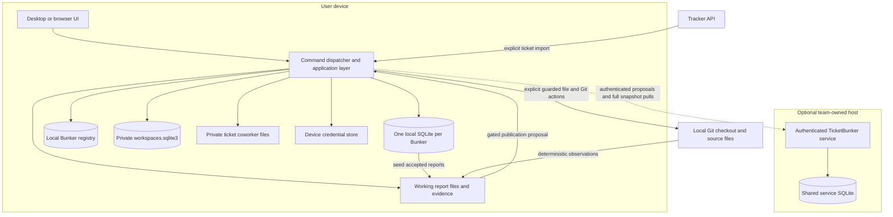
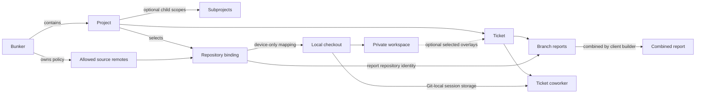
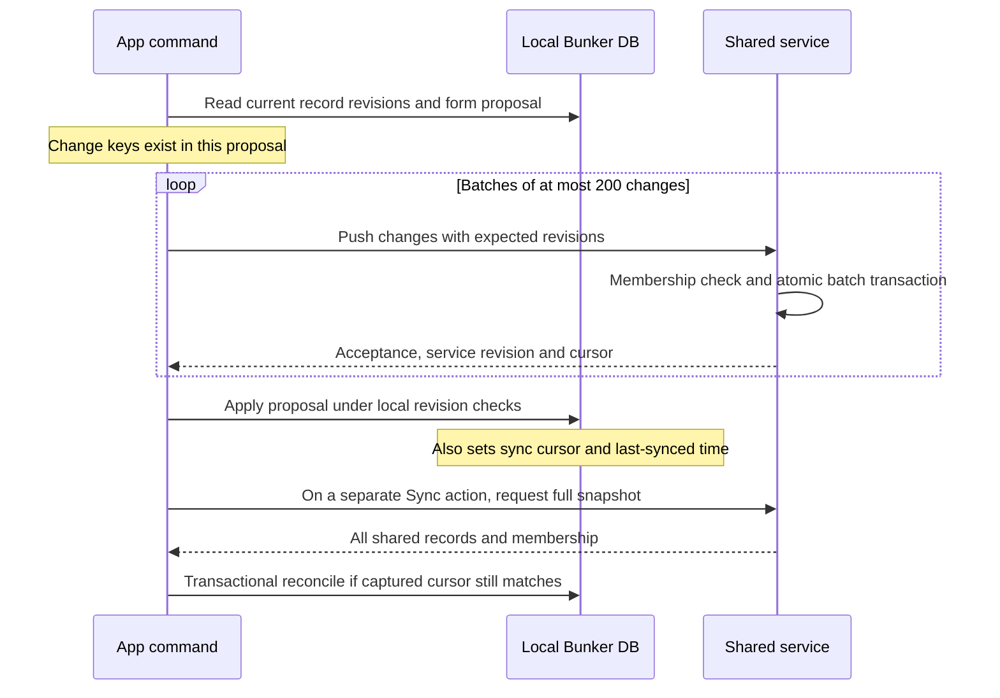

# Current architecture

Implemented at `d6c8cb5`. Dashed arrows are optional relationships, not implicit membership or synchronization.

## Ownership

The tracker supplies imported ticket facts. TicketBunker owns its configuration, permitted repository bindings, branch assignments, and accepted reports. A local-only Bunker's local database is authoritative. Once shared, the service is authoritative for shared records; the device database is a replica. Source Git owns the actual code/refs, never Bunker membership.

| Store | Purpose and authority | Shared? |
|---|---|---|
| Host `ServiceStore` SQLite | Bunkers, users, roles, records, revisions, accepted change keys | Authority for shared Bunkers |
| `bunkers/registry.sqlite3` | Which Bunkers exist on this device | No |
| `bunkers/<local-id>/bunker.sqlite3` | Local authority or shared replica; also contains local folder attachments/sync receipts | Only selected shared records |
| `workspaces.sqlite3` | Checkout-keyed tabs, buffers, view state, selected overlays, optimistic revision | No |
| Bunker runtime directory | Derived ticket context, observation artifacts, report working copies and acceptance receipts | Not as a database snapshot |
| Git-local coworker directory | Ticket/user chat, proposals and agent session files | No |
| Credential file | Tokens addressed by opaque local references | No |
| Source checkout | User's code, branch/HEAD and Git objects | Through the user's Git workflow, not Bunker sync |

Private and shared records already coexist inside a local Bunker SQLite file. Publication must remain an explicit whitelist; copying that whole file is not a portable sharing/export protocol.

Sources: [local schema](https://github.com/TimothyBunker/TicketBunker/blob/d6c8cb5/ticketbunker/bunkerdb.py#L173), [service schema](https://github.com/TimothyBunker/TicketBunker/blob/d6c8cb5/ticketbunker/service/storage.py#L109), [workspace store](https://github.com/TimothyBunker/TicketBunker/blob/d6c8cb5/ticketbunker/workspace.py#L34), [runtime reconciliation](https://github.com/TimothyBunker/TicketBunker/blob/d6c8cb5/ticketbunker/bunkerruntime.py#L85), [coworker identity](https://github.com/TimothyBunker/TicketBunker/blob/d6c8cb5/ticketbunker/coworker.py#L143).

## Domain relationships

A Project is not a repository or a database. One source repository can be available to multiple Projects. A shared binding currently maps to one local path per device; this is not yet a first-class many-checkout/worktree registry. The UI supports optional ticket overlays, but opening a workspace still requires Bunker/repository binding IDs. The coworker remains ticket-centric.

## Shared write and pull, as implemented

Each batch is atomic at the service; the entire multi-batch operation is not. No cross-network transaction joins service commit to local apply. A snapshot pull is transactional on both ends and guarded against a newer completed local synchronization. The write acknowledgement is currently conflated with the read cursor: see [findings](findings.md).

Sources: [publish batches](https://github.com/TimothyBunker/TicketBunker/blob/d6c8cb5/ticketbunker/application.py#L906), [service transaction](https://github.com/TimothyBunker/TicketBunker/blob/d6c8cb5/ticketbunker/service/storage.py#L737), [snapshot command](https://github.com/TimothyBunker/TicketBunker/blob/d6c8cb5/ticketbunker/application.py#L1502), [snapshot apply](https://github.com/TimothyBunker/TicketBunker/blob/d6c8cb5/ticketbunker/bunkerdb.py#L3219).
