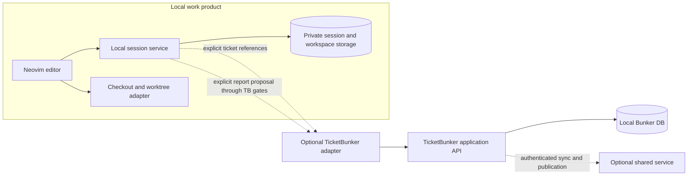
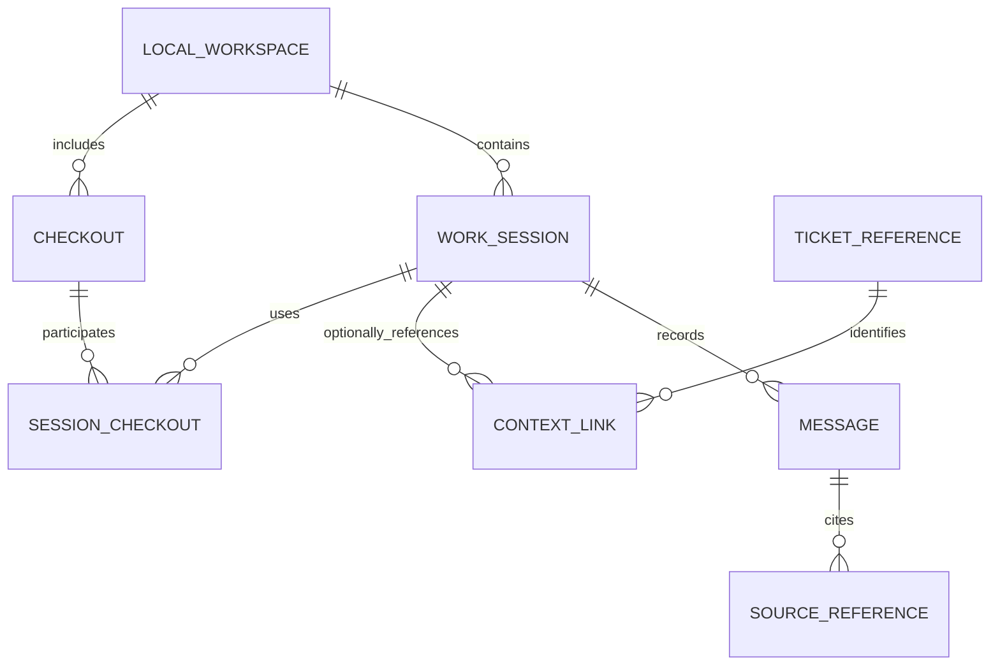
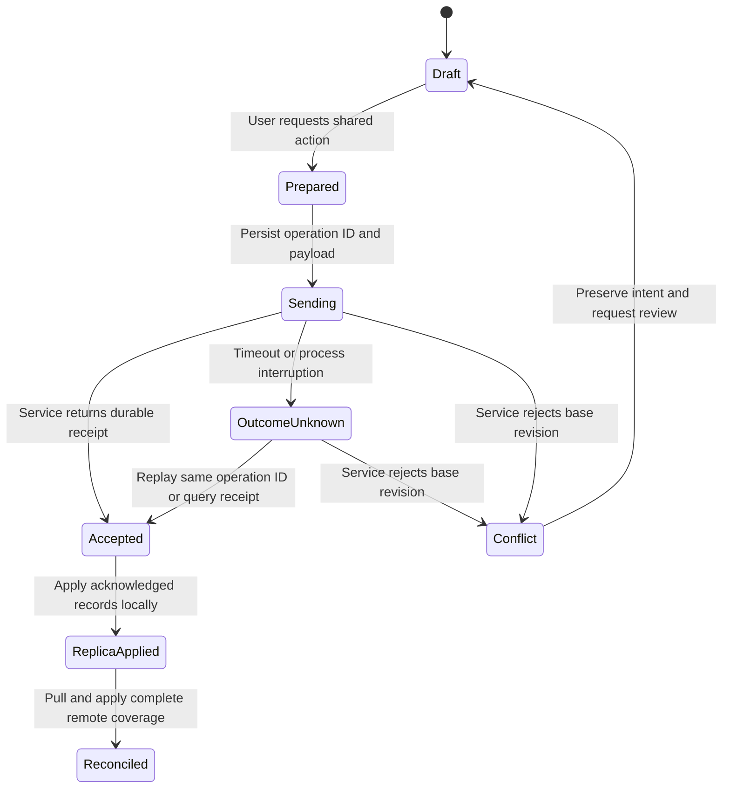

# Independent editor and sessions — proposal

**Proposed, not implemented.** This note reflects the new direction described by Tim: a Neovim-specialized local work environment that can use TicketBunker, but neither requires it nor exists solely to complete tickets. It does not redefine the existing ticket coworker as a coding agent.

## Product contract

Opening a repository and creating a work session should require neither a Bunker, a Project, a ticket, a remote server nor an agent login. Model-backed actions can require model authentication when invoked. TicketBunker is an optional context/publication provider.

The editor owns its buffers, navigation, work sessions and any independent work-agent policy. TicketBunker owns ticket facts, permissioned shared configuration and accepted ticket reports. Reading ticket context gives a work session no implicit right to change tracker truth, publish reports, edit files or execute commands.

## Dependency boundary

The editor should not read `bunker.sqlite3` or runtime files directly. The adapter returns versioned context and accepts typed proposals. Similarly, TicketBunker should not need access to every private buffer or conversation. The stores shown are logical owners; deciding whether local session storage is a separate file/process comes after agreeing the contract.

## Identity model

- **Workspace ID:** opaque local identity, not a project/ticket key. Scope can contain multiple checkouts.
- **Checkout ID:** stable local record with path and Git/worktree identity. Canonical remote is descriptive/matching data, not an authorization credential. Moving/replacing a checkout requires explicit reconciliation.
- **Session ID:** opaque durable identity. A session may reference zero, one or multiple tickets and checkouts. Display title can change without moving its storage.
- **Ticket reference:** fully qualified `(provider/authority, Bunker ID, ticket ID)` plus selected context revision. Use remote Bunker identity when shared; maintain a mapping when a local Bunker is shared later. Never identify a ticket by `ECS-4` alone.
- **Source reference:** checkout ID + relative path + observed branch/commit and content digest + line/range. Mark unsaved-buffer references explicitly; line numbers alone do not remain valid across edits.
- **Context link:** an explicit relationship, not ownership. Removing it must not delete the local session; a revoked/unreachable provider marks it unavailable rather than preventing local work.

One session can relate to multiple tickets. This is not an instruction to merge today's per-ticket coworker histories automatically. Any migration must preserve origin and avoid cross-Bunker collisions.

## Proposed synchronization states

`Accepted` and `Reconciled` are different promises. An action may be saved remotely while other team changes have not yet reached this device. Source-buffer saves are separate from this state machine: they write the local checkout under file/branch conflict guards, not the shared Bunker.

## Smallest useful integration slice

1. Local session create/list/resume works with no TicketBunker installation or service.
2. Optional adapter can attach/detach a fully qualified ticket and retrieve a versioned context snapshot.
3. The editor can send a source selection with explicit checkout/commit/buffer provenance.
4. Report proposals use one existing-or-hardened TicketBunker publication gate, never direct Combined writes.
5. Leaving a ticket, disconnecting a Bunker, losing the network, or changing a display name does not destroy the session.

Acceptance scenarios: unticketed maintenance; one task spanning two checkouts; two unrelated Bunkers both containing `ECS-4`; branch switching while a cited buffer is dirty; revoked ticket access with local work still usable; exporting a ticket report without exporting a private chat.

Open decisions for a later implementation discussion: whether the local session API is embedded or a separate process; which messages can ever be shared; backup scope for private sessions; and whether a work-agent exists in the new editor at all. None needs to be settled by expanding TicketBunker's authority over source work.
