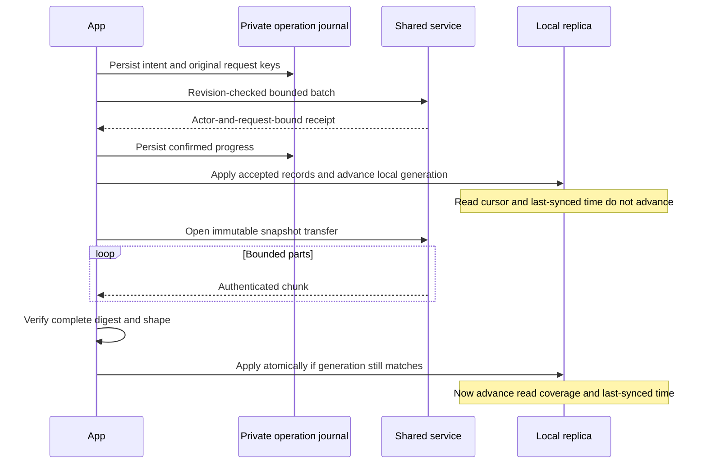

# Repair progress — 2026-09-19

Implementation follow-up to [the findings](findings.md). These are source
changes, not a published installer or database-engine migration.

## Implemented in this pass

- **F1:** separate write receipts from read coverage; a local generation rejects
  a snapshot made obsolete by intervening accepted writes. One-time migration
  clears old ambiguous freshness claims, retaining replica data.
- **F2:** durable private operation journal, stable retry keys, bounded batches,
  receipt validation and uncertain-outcome recovery at Bunker sync. A process
  can exit after service commit and recover without a duplicate write.
  Conflict intent remains stored; the app keeps its warning visible while
  displaying successfully refreshed shared data. A reviewed new save covering
  outstanding records supersedes that failed intent.
- **F3:** service-side branch structure/stamp validation, content-derived report
  revisions, and Combined derivation checks on both changes and initial share.
  Child-only writes regenerate Combined at the service. Verification metadata
  identifies client attestation, submitting member and content hash; it does
  not pretend the host can inspect unavailable source code.
- **F4, pull/join:** immutable, authenticated, digest-checked snapshot chunks
  remove the single-response 8 MiB cliff. Partial/corrupt downloads cannot
  replace the replica. Transfers belong to the requesting member and expire.
- Receipt keys now bind to the actor and request content, preventing a reused
  key from silently acknowledging a different change.

## Still open

- **F4, initial sharing:** uploads still have an 8 MiB request limit. A staged
  upload protocol is needed; increasing the limit is not the fix.
- True incremental sync, selective report loading, indexed catalog filtering.
  Chunks bound transport, not total server work or the full in-memory read model.
- **F5:** independent local workspace/session identities and cross-Bunker
  coworker namespace migration. No Neovim integration or private-history
  migration was attempted in this data-flow pass.
- Portable export/restore, deletion/retention, membership recovery/removal and
  the other P2 operational work in the audit.
- PostgreSQL for production remote storage and a secure self-hosting setup path.
  Local SQLite remains. No remote host/database was created.

## Updated flow

Tests live in `tests/test_database_flow.py`; existing service/application/runtime
tests remain. The original audit probe is historical, not a regression test of
desired behavior. Verification: full core suite **532 run, 3 skipped, no failures**;
subsequent focused checks **68 passed**, final migration/database checks **50
passed**; all **204 UI tests passed** and the UI build succeeded. Native installers
and PostgreSQL were not tested. Details are recorded in HANDOFF.md.
